# 📝 Awesome Online Form Builder & Data Collection 📊

  
  
  
  
  

  <strong>🚀 A curated directory of top Online Form Builder &amp; Data Collection platforms — comparing enterprise SaaS platforms with open-source alternatives for surveys, questionnaires, lead generation, and dynamic workflows. 🎯</strong>

  🌟 <em>Star this repo if you find it useful!</em> 🌟

---

## 📋 Table of Contents 📑

- [🌐 Sector Overview & Market Dynamics](#-sector-overview--market-dynamics)
- [🟦 SaaS / Hosted Platforms](#-saas--hosted-platforms)
- [🟩 Open-Source Software](#-open-source-software)
  - [⚡ Full-Stack Form & Survey Platforms](#-full-stack-form--survey-platforms)
  - [🧩 Developer SDKs & Embeddable Schema Builders](#-developer-sdks--embeddable-schema-builders)
  - [🔌 Framework-Specific Solutions](#-framework-specific-solutions)
- [📊 Feature Comparison Matrix](#-feature-comparison-matrix)
- [📈 Star History](#-star-history)
- [💖 Support & Sponsorship](#-support--sponsorship)
- [🤝 Contributing](#-contributing)
- [📄 License](#-license)

---

## 🌐 Sector Overview & Market Dynamics 📈

The global online form builder and digital data collection software market is valued between **$800 million and $1.2 billion** 💰, compounding at a healthy **10%–14% CAGR** 🚀 as organizations transition away from static paperwork and legacy spreadsheets toward automated, digital workflow pipelines. 

The industry exhibits a **highly fragmented** competitive structure rather than a "winner-take-all" monopoly 🌐: while hyperscale cloud ecosystems (such as Google Workspace and Microsoft 365) absorb massive volumes of casual, commoditized surveys at zero marginal cost ☁️, specialized SaaS vendors (like Typeform and Jotform) thrive by differentiating on conversational UI/UX, conditional branching logic, payment gateways, and CRM/ERP integrations 💡, while security-conscious enterprises and developers increasingly adopt self-hosted, AGPL/MIT open-source solutions for strict privacy, GDPR, and data sovereignty compliance 🛡️.

---

## 🟦 SaaS / Hosted Platforms ☁️

Below is a detailed breakdown of leading commercial, cloud-hosted form builders and data collection suites, sorted in descending order by company scale (market capitalization, private equity acquisition valuation, or institutional valuation) 🏢.

| Platform | Company Scale (Valuation / Revenue) | Starting Tier Pricing | Free Plan / Trial Limit | Key Highlights & Architecture |
|:---|:---|:---|:---|:---|
| **[Microsoft Forms](https://forms.office.com/)** 🔷 | **~$3.85T Market Cap** (Microsoft NASDAQ: MSFT) | **$7.00/user/month** *(Microsoft 365 Business Basic, annual)*; personal plans start at **$6.99/mo** | **Free forever plan:** Capped at **200 responses per form/quiz** for free personal Microsoft accounts (scales to 5,000,000 responses on paid M365) 🎁 | Integrated natively with Microsoft 365, Excel live sync, and Copilot AI; ideal for enterprise environments standardized on Microsoft Azure/Office. 🏢 |
| **[Google Forms](https://www.google.com/forms/about/)** 🟡 | **~$3.80T Market Cap** (Alphabet NASDAQ: GOOGL) | **$7.00/user/month** *(Google Workspace Business Starter, annual commitment)* | **Free forever plan:** **100% free** with unlimited forms and responses; file uploads consume the user's shared 15 GB Google Drive storage 🆓 | Zero-friction entry point deeply integrated with Google Sheets, Workspace collaboration, and Drive ecosystem; lightweight conditional sections. 📊 |
| **[Wufoo](https://www.wufoo.com/)** 🦕 | **~$1.5B Valuation** *(Acquired by STG via Momentive/SurveyMonkey; ~$380M ARR)* | **$16.25/month** *(Starter Plan, billed annually)* | **Free forever plan:** Up to **5 forms**, max **10 fields per form**, and **100 entries/month** (1 user seat, no file uploads) 📝 | Veteran HTML drag-and-drop form and survey builder with automated payment processing, instant notification triggers, and built-in reporting. 🛠️ |
| **[Typeform](https://www.typeform.com/)** 💬 | **~$935M Valuation** *(Series C; ~$100M+ ARR)* | **$39/month** *(Basic Plan, monthly)* or **$28/month** *(billed annually)* | **Free forever plan:** Unlimited forms, but capped at **10 responses/month** across the entire account; includes Typeform branding 🏷️ | Pioneer of the conversational "one-question-at-a-time" user experience; industry-leading design aesthetics, high completion rates, and smart logic jumps. ✨ |
| **[Formstack](https://www.formstack.com/)** 📑 | **~$425M+ Valuation** *(Raised $425M from Silversmith & PSG; ~$50M+ ARR)* | **$83/month** *(Forms Plan, billed annually)* or **$99/month** *(monthly)* | **14-day free trial** with full access to test builder and submissions; **no permanent free tier** ⏳ | Enterprise-grade workflow automation suite combining secure form creation, document generation, and native e-signatures with HIPAA compliance. 🔒 |
| **[Jotform](https://www.jotform.com/)** 📄 | **~$145M ARR** *(Bootstrapped, highly profitable; 500+ employees)* | **$34/month** *(Bronze Plan, billed annually)* or **$39/month** *(monthly)* | **Free forever plan (Starter):** Up to **5 active forms**, **100 monthly submissions**, **10 payment submissions**, and **100 MB storage** 📦 | Extremely versatile drag-and-drop builder featuring 10,000+ templates, payment gateway integrations, e-signatures, tables, and mobile PDF generation. 💳 |

---

## 🟩 Open-Source Software 🔓

Self-hosted, transparent, and community-driven Online Form Builder and Data Collection tools. Ranked in **descending order by GitHub star count** ⭐.

### ⚡ Full-Stack Form & Survey Platforms

*   **[Formbricks](https://github.com/formbricks/formbricks)**  🧱
    *   **Stack:** TypeScript / Next.js / PostgreSQL / Tailwind / Docker | **License:** AGPLv3 (core) 📜
    *   **Description:** The leading open-source Experience Management (XM) and survey platform. Features in-app targeting based on user attributes, lightweight 7KB website micro-surveys, custom link forms, 20+ question types, conditional skip logic, and privacy-first German/EU GDPR compliance 🇪🇺.
    *   **Best for:** Product and engineering teams wanting targeted in-app feedback and survey orchestration without vendor lock-in 🎯.

*   **[Typebot](https://github.com/baptisteArno/typebot.io)**  🤖
    *   **Stack:** Next.js / TypeScript / Prisma / PostgreSQL / Docker | **License:** Source-available / Fair Core 📜
    *   **Description:** Visual conversational form and chatbot builder that enables embedding interactive, real-time conversational forms into web applications with native webhook triggers, API calls, and analytics 💬.
    *   **Best for:** High-converting conversational lead capture, onboarding flows, and conversational survey experiences 🚀.

*   **[HeyForm](https://github.com/heyform/heyform)**  👋
    *   **Stack:** TypeScript / Node.js / React / Docker | **License:** AGPL-3.0 📜
    *   **Description:** Polished open-source Typeform alternative with an interactive conversational builder, AI-driven form generation, multi-endings, complex branching logic, custom domains, and payment collection 🤖💳.
    *   **Best for:** Teams seeking a Typeform-like design and multi-step conversational experience with complete self-hosting autonomy 🌟.

*   **[OpnForm](https://github.com/OpnForm/OpnForm)**  📋
    *   **Stack:** Laravel / Nuxt / PostgreSQL / Redis / Docker | **License:** AGPL-3.0 📜
    *   **Description:** Modern open-source form builder with drag-and-drop creation, shareable links, embeds, webhooks, Slack/Discord notifications, and optional OpenAI integration for automatic form generation 🧠.
    *   **Best for:** Fast contact forms, lead generation, feedback widgets, and community forms 📬.

*   **[Xiaoju Survey](https://github.com/didi/xiaoju-survey)**  🍊
    *   **Stack:** Node.js / Vue 3 / TypeScript / Docker | **License:** Apache-2.0 📜
    *   **Description:** Enterprise-scale online survey and examination platform developed by Didi. Supports complex questionnaires, online tests, multi-channel distribution, logic rules, and rich data analytics 📊.
    *   **Best for:** Large enterprise questionnaires, student/employee quizzes, exams, and cross-platform surveys 🏢.

*   **[LimeSurvey](https://github.com/LimeSurvey/LimeSurvey)**  🍋
    *   **Stack:** PHP / MySQL / PostgreSQL / Docker | **License:** GPL-2.0 📜
    *   **Description:** The gold standard of open-source statistical survey engines. Offers limitless question logic, token-based respondent tracking, quota management, multi-language support (80+ languages), and export to SPSS, R, CSV, and Excel 🔬.
    *   **Best for:** Academic research, statistical polling, university studies, and enterprise market surveys 🎓.

*   **[ohmyform](https://github.com/ohmyform/ohmyform)**  ⛺
    *   **Stack:** Node.js / Vue / Python / Docker | **License:** AGPL-3.0 📜
    *   **Description:** Community-driven alternative to Typeform and Google Forms (successor to TellForm). Provides an easy UI for generating beautiful forms, managing submissions, and exporting data 📝.
    *   **Best for:** Self-hosters looking for a lightweight, accessible open-source questionnaire builder 🎈.

*   **[LiberaForms](https://codeberg.org/LiberaForms/server)**  🕊️
    *   **Stack:** Python / Flask / PostgreSQL / VueJS | **License:** AGPLv3 📜
    *   **Description:** Ethical, privacy-first form software supporting client-side end-to-end encryption (E2EE with OpenPGP.js), Fediverse publishing, and strict European GDPR compliance 🔐. 
    *   **Best for:** Organizations prioritizing data privacy, medical/legal compliance, and European digital sovereignty 🛡️.

---

### 🧩 Developer SDKs & Embeddable Schema Builders

*   **[SurveyJS Library & Creator](https://github.com/surveyjs/survey-library)**  📐
    *   **Stack:** TypeScript / JavaScript (React, Angular, Vue 3, Knockout) | **License:** MIT (Core Library) 📜
    *   **Description:** Deeply customizable client-side form modeling engine and dynamic JSON-driven form generator. Allows developers to embed no-code form builders directly into their internal dashboards and SaaS products 🛠️.
    *   **Best for:** Developers building proprietary software who need to render dynamic surveys from JSON schemas 💻.

*   **[kevinchappell/formBuilder](https://github.com/kevinchappell/formBuilder)**  🧱
    *   **Stack:** JavaScript / jQuery | **License:** MIT 📜
    *   **Description:** Battle-tested 100% client-side visual drag-and-drop form builder plugin. Exports form definitions as raw JSON or XML for effortless backend persistence 📦.
    *   **Best for:** Embedding a simple drag-and-drop form creation component into legacy or lightweight web tools 🔌.

*   **[shadcn-labs/form-builder](https://github.com/shadcn-labs/form-builder)**  🎨
    *   **Stack:** React / TypeScript / Tailwind CSS / Radix UI | **License:** MIT 📜
    *   **Description:** Modern, accessible form building tool built on top of shadcn/ui primitives and React Hook Form, enabling fast visual composition of validated web forms ✨.
    *   **Best for:** Modern React/Next.js applications leveraging Tailwind and shadcn/ui component architecture ⚛️.

*   **[Form.io](https://github.com/formio/formio)**  🌐
    *   **Stack:** JavaScript / Node.js / REST API / Docker | **License:** Open Software License 3.0 (OSL-3.0) 📜
    *   **Description:** Enterprise Progressive Web App (PWA) form and data management platform combining a drag-and-drop JSON form builder with an automatic serverless REST API backend 🚀.
    *   **Best for:** Building mission-critical form applications requiring automatic schema-backed REST endpoints 📡.

*   **[vazco/uniforms](https://github.com/vazco/uniforms)**  👔
    *   **Stack:** TypeScript / React / Zod / JSONSchema | **License:** MIT 📜
    *   **Description:** Declarative form generator for React that creates complete, interactive forms automatically from any schema (Zod, JSON Schema, GraphQL, SimpleSchema) 🎯.
    *   **Best for:** Schema-driven dynamic forms with instant validation across diverse frontend UI component kits 🖼️.

---

### 🔌 Framework-Specific Solutions

*   **[QuillForms](https://github.com/quillforms/quillforms)**  🪶
    *   **Stack:** React / TypeScript / PHP (WordPress Plugin) | **License:** GPL-3.0 📜
    *   **Description:** Open-source Typeform alternative tailored for WordPress sites. Delivers smooth conversational step-by-step forms, logic jumps, styling hooks, and payment integrations 🌐.
    *   **Best for:** WordPress publishers requiring conversational forms without paying monthly SaaS subscriptions 📰.

*   **[Formy](https://github.com/FahimFBA/formy)**  🐍
    *   **Stack:** Python / Django / React / Tailwind / Docker | **License:** MIT 📜
    *   **Description:** Embeddable and vendor-ready Django forms engine with a modern React dashboard. Features raw submission tables, time-series charts, PDF/CSV export, and embed widgets 📈.
    *   **Best for:** Python & Django developers wanting a ready-to-vendor form management package 💻.

---

## 📊 Feature Comparison Matrix 📑

| Solution | Deployment | License | Conversational UI | Conditional Branching | AI Form Generation | E2E Encryption / Privacy | Best Use Case |
|:---|:---|:---|:---:|:---:|:---:|:---:|:---|
| **Microsoft Forms** 🔷 | Cloud SaaS | Proprietary | ❌ | ✅ | ✅ (Copilot) | Enterprise Cloud ☁️ | Microsoft 365 Teams & Workplaces |
| **Google Forms** 🟡 | Cloud SaaS | Proprietary | ❌ | Limited | ❌ | Workspace Cloud ☁️ | Quick zero-cost general surveys |
| **Wufoo** 🦕 | Cloud SaaS | Proprietary | ❌ | ✅ | ❌ | Standard Cloud ☁️ | Small business registrations |
| **Typeform** 💬 | Cloud SaaS | Proprietary | ✅ | ✅ | ✅ | Standard Cloud ☁️ | High-conversion marketing forms |
| **Formstack** 📑 | Cloud SaaS | Proprietary | ❌ | ✅ | ❌ | HIPAA Compliant 🏥 | Complex document & sign workflows |
| **Jotform** 📄 | Cloud SaaS | Proprietary | Optional | ✅ | ✅ | HIPAA Tiered 🏥 | Versatile business forms & e-commerce |
| **Formbricks** 🧱 | Self-Hosted / Cloud | AGPLv3 | ✅ | ✅ | ✅ | GDPR Compliant 🇪🇺 | Targeted in-app XM & website surveys |
| **Typebot** 🤖 | Self-Hosted / Cloud | Source-Available | ✅ | ✅ | ✅ | Self-Controlled 🛡️ | Interactive chat flows & lead capture |
| **HeyForm** 👋 | Self-Hosted / Cloud | AGPL-3.0 | ✅ | ✅ | ✅ | Self-Controlled 🛡️ | Conversational Typeform replacement |
| **OpnForm** 📋 | Self-Hosted / Cloud | AGPL-3.0 | ❌ | ✅ | ✅ | Self-Controlled 🛡️ | Community feedback & lead intake |
| **Xiaoju Survey** 🍊 | Self-Hosted | Apache-2.0 | ❌ | ✅ | ❌ | Internal On-Prem 🏢 | Enterprise exams, polls & quizzes |
| **LimeSurvey** 🍋 | Self-Hosted / Cloud | GPL-2.0 | ❌ | ✅ | ❌ | Academic Sovereign 🎓 | Academic research & statistical studies |
| **ohmyform** ⛺ | Self-Hosted | AGPL-3.0 | ✅ | ✅ | ❌ | Self-Controlled 🛡️ | Minimalist self-hosted web forms |
| **SurveyJS** 📐 | Embedded SDK | MIT / Commercial | Optional | ✅ | ❌ | In-App Sovereign 💻 | Custom dynamic forms in React/Vue |
| **LiberaForms** 🕊️ | Self-Hosted | AGPLv3 | ❌ | ✅ | ❌ | OpenPGP E2EE 🔐 | Strict European GDPR & E2EE forms |
| **QuillForms** 🪶 | WordPress Plugin | GPL-3.0 | ✅ | ✅ | ❌ | WordPress Native 🌐 | WordPress conversational forms |
| **Formy** 🐍 | Self-Hosted | MIT | ❌ | ✅ | ❌ | Django Native 🐍 | Django standalone or vendored apps |

---

## 📈 Star History ⭐

---

## 💖 Support & Sponsorship ☕

Thank you so much for using and exploring **Awesome Online Form Builder & Data Collection**! 🙌

If this project has saved you hours of research, helped you discover a great self-hosted alternative, or assisted your engineering team:

- ⭐ **Star this repository** to show your appreciation and help others discover it!
- 🍴 **Fork the repo** to add your favorite form tools and contribute back.
- 📢 **Share with colleagues & friends** across Twitter/X, LinkedIn, Reddit, and developer communities.
- ☕ **Support continuous development and curation:** Consider buying a coffee or sponsoring ongoing open-source research via the **[GitHub Sponsor Dashboard](https://github.com/sponsors/ishandutta2007)**! Your support directly funds regular ecosystem audits, benchmark updates, and new open-source discoveries.

---

## 🤝 Contributing 🚀

Contributions are warmly welcome! 🎉 If you know of an active open-source form builder, survey tool, or data collection library that should be included:

1. 🍴 Fork this repository.
2. 🌿 Create a new feature branch (`git checkout -b add-tool-name`).
3. 📝 Add the tool to the appropriate category in alphabetical or star-ranked order.
4. 🏷️ Include the project's repository link, GitHub star badge (`style=social&color=white`), stack, license, and primary use case.
5. 🚀 Submit a Pull Request with a clear description of the project.

---

## 📄 License 📜

This repository is distributed under the [Creative Commons Zero v1.0 Universal](LICENSE) (CC0 1.0) Public Domain Dedication. Listed software platforms and repositories retain their respective individual licenses.
